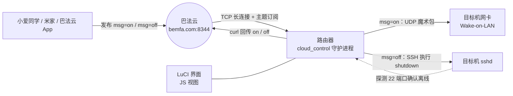

# 云端开关机 · luci-app-cloud-control

> 路由器订阅巴法云（bemfa.com）主题，把「小爱同学 / 米家」的一句话变成局域网电脑的开机与关机。


- **开机**：程序自己发 UDP 魔术包（Wake-on-LAN），目标机不用装任何软件
- **关机**：SSH 登录目标机执行 `shutdown`，**成功之后才回报云端**
- **零依赖**：`/usr/bin/cloud_control` 是静态链接的单个文件，不依赖 libuci / libubox / etherwake，也不受固件 libc（musl / glibc）版本影响
- **不挑固件**：界面是 JS 视图，OpenWrt 19.07 ~ 25.12+ 通用，不需要 `luci-compat`

---

## 目录

- [这是什么](#这是什么)
- [特性](#特性)
- [工作原理](#工作原理)
- [为什么不用 .ipk](#为什么不用-ipk)
- [安装](#安装)
- [目标机准备（Windows）](#目标机准备windows)
- [配置项](#配置项)
- [验证](#验证)
- [故障排查](#故障排查)
- [命令行](#命令行)
- [目录结构](#目录结构)
- [与上游的差异](#与上游的差异)
- [安全说明](#安全说明)
- [已知限制](#已知限制)
- [开发与构建](#开发与构建)
- [致谢与许可](#致谢与许可)

---

## 这是什么

一个 OpenWrt / LEDE 路由器插件。它保持一条到巴法云的长连接，订阅你指定的主题：

- 收到 `msg=on` → 向局域网广播 Wake-on-LAN 魔术包，把电脑唤醒
- 收到 `msg=off` → SSH 登录电脑执行 `shutdown`，然后（可选）探测端口确认真的关机了

配合米家 / 小爱同学里绑定的巴法云设备，就能实现「小爱同学，打开电脑 / 关闭电脑」。

**开机和关机是两条完全独立的链路**，这一点决定了你的配置和排障方向：

| 动作 | 实现方式 | 需要配的参数 | 目标机要装什么 |
|---|---|---|---|
| `on` | 程序自己构造 UDP 魔术包广播 | MAC 地址、出口网卡 | 不用装任何软件，但 BIOS 和网卡要开 Wake-on-LAN |
| `off` | `ssh` 登录执行 `shutdown` | IP、端口、用户名、密码或密钥 | **必须装 SSH 服务端**（Windows 装 OpenSSH 服务器） |

> 所以「能开机但关不了机」几乎一定是 SSH 那一侧的问题，与巴法云、与 WoL 都无关。

---

## 特性

**云端接入**

| 功能 | 说明 |
|---|---|
| TCP 长连接 | 连接 `bemfa.com:8344`，订阅指定主题 |
| 断线自愈 | 连接失败每 10 秒重试；收到 FIN 或心跳失败立即重连并重新订阅 |
| 心跳保活 | 每 20 秒一次（留了余量，不卡在服务端 30 秒超时线上） |
| 配置热重载 | 每 60 秒复查配置；改 IP / 密码 / MAC 即时生效，改 Client ID / Topic 会自动断开重订阅 |
| 防误触发 | 报文只从 `msg=` / `message=` 字段取值，不做逐 token 匹配 |
| 防自激循环 | 自家上报的 `on/off` 被云端回显时 10 秒内丢弃；同类指令限流（on 10s / off 30s） |

**开机（Wake-on-LAN）**

| 功能 | 说明 |
|---|---|
| 原生发魔术包 | 程序自己构造 102 字节报文，UDP 广播，不依赖 `etherwake` |
| 绑定出口网卡 | `SO_BINDTODEVICE` 锁定网卡，多网口软路由不会把广播发到 WAN 侧 |
| MAC 校验 | 支持 `:` 与 `-` 两种分隔，格式错当场拒绝并给出示例 |

**关机（SSH）**

| 功能 | 说明 |
|---|---|
| 自动识别客户端 | 固件里的 `ssh` 可能是 dropbear 的 `dbclient`，也可能是 OpenSSH，两者参数不兼容，程序会先 `ssh -V` 判断再分别下参数 |
| 密码安全传递 | `sshpass -e` + 仅子进程可见的环境变量，密码不出现在 `ps` 里 |
| 密钥登录 | 密码留空则显式 `-i` 指定私钥，不依赖 `$HOME` 展开 |
| 免交互 | 自动接受未知主机密钥；主机密钥发生变化时仍会拒绝（防中间人） |
| 超时保护 | 单次执行 15 秒上限，卡住不会拖死 Web 请求 |
| 结果如实回报 | **执行成功才报 `off`**，失败报 `on` 并记 ERROR |
| 关机确认（可选） | 探测目标机 SSH 端口，连续 3 次无响应才认为真的关机，避免「说关了其实还开着」 |

**运行保障**

| 功能 | 说明 |
|---|---|
| procd 托管 | 崩溃自动拉起，`SIGTERM` 优雅退出 |
| 日志轮转 | 超过上限（默认 256 KB）转成 `.log.1`，不会写满内存盘 |
| 敏感信息脱敏 | `client_id` 只记前 4 位，密码永不落日志 |
| 分包容错 | 4 KB 行缓冲，TCP 半包不会丢指令 |

**界面**

| 功能 | 说明 |
|---|---|
| 状态与启停 | 绿/红圆点显示运行状态，一键启动 / 停止 / 重启 |
| 字段校验 | IP 走 `ip4addr`、端口走 `port`、MAC 走正则，填错保存时就拦下 |
| 三个测试按钮 | 巴法云连通 / 发魔术包 / 试 SSH 关机，各自显示**原始输出和退出码** |
| 日志面板 | 页面内看最后 60 行，可刷新、可清空 |
| 写操作防护 | 启停与测试都要带会话 token，防跨站诱导 |

---

## 工作原理



一次完整的关机是这样走的：

```
巴法云 → 收到 msg=off
      → fork + execvp: ssh [-i 私钥] user@host "shutdown /s /t 10 /f"
      → 成功？ 是 → （可选）轮询 22 端口，连续 3 次不通 → 回报 off
               否 → 回报 on + ERROR 日志
```

---

## 为什么不用 .ipk

OpenWrt 官方从 25.12 起把包管理器从 **opkg 换成了 apk**，`.ipk` 已经装不上；而 apk 包需要签名，离线自制容易被拒。

但**第三方改版固件不一定跟着换**（例如 BleachWrt 基于 25.12 分支，仍然是 opkg）。

所以本项目默认的安装方式是**不走包管理器**：直接放文件 + 注册服务。对 apk 和 opkg 固件都适用，也不占包数据库。

另外，**LuCI 25.12 已移除 Lua CBI 兼容层**，旧式 `luci.model.cbi` 配置页在新固件上根本不会显示。本项目的界面是 JS 视图（`htdocs/luci-static/resources/view/`），19.07 ~ 25.12+ 通用。

### 为什么是静态二进制

`/usr/bin/cloud_control` 是 `ELF64 EXEC` 的静态链接产物：无 `INTERP` 段、无 `NEEDED` 依赖，约 86 KB（x86_64）/ 104 KB（aarch64）。

它不链接 libuci / libubox，配置由程序自己解析；也不调用 `etherwake`，魔术包自己发。换来的是：**换固件版本、换 libc 都不会出现「装上了但起不来」**。

---

## 安装

### 方式一：预编译包（推荐）

到 [Releases](https://github.com/YOUR_NAME/luci-app-cloud-control/releases) 下载对应架构的压缩包，传到路由器安装：

```bash
scp luci-app-cloud-control-2.1.7-x86_64.tar.gz root@192.168.1.1:/tmp/

ssh root@192.168.1.1
cd /tmp
tar -xzf luci-app-cloud-control-2.1.7-x86_64.tar.gz
cd luci-app-cloud-control
sh install.sh
```

装完打开 **LuCI → 服务 → 云端开关机**。

菜单里没有就执行：

```bash
rm -f /tmp/luci-indexcache*
/etc/init.d/rpcd restart
```

然后按 `Ctrl+F5` 强制刷新浏览器。

卸载：

```bash
cd /tmp/luci-app-cloud-control && sh uninstall.sh
```

配置会备份到 `/etc/config/cloud_control.bak`（含明文密码，注意保管）。

### 方式二：从源码构建

```bash
git clone https://github.com/YOUR_NAME/luci-app-cloud-control.git
cd luci-app-cloud-control

# 取 musl 交叉工具链（约 110 MB）
curl -LO https://musl.cc/x86_64-linux-musl-cross.tgz
tar -xzf x86_64-linux-musl-cross.tgz

./build.sh --toolchain "$PWD/x86_64-linux-musl-cross"
```

产物：`luci-app-cloud-control-2.1.7-x86_64.tar.gz`。

> ARM 设备把工具链和 `--arch` 换成 `aarch64`：
> `curl -LO https://musl.cc/aarch64-linux-musl-cross.tgz`，然后
> `./build.sh --arch aarch64 --toolchain "$PWD/aarch64-linux-musl-cross"`

### 方式三：用 OpenWrt SDK 编成 apk / ipk

两个包都是标准写法，可以直接当作 feed 使用：

```bash
# 把仓库放进 SDK
cd openwrt-sdk
echo "src-git cloudcontrol https://github.com/YOUR_NAME/luci-app-cloud-control.git" \
  >> feeds.conf.default
./scripts/feeds update cloudcontrol
./scripts/feeds install -a -p cloudcontrol

make menuconfig     # LuCI → Applications → luci-app-cloud-control
make package/cloud-control/compile V=s
make package/luci-app-cloud-control/compile V=s
```

---

## 目标机准备（Windows）

**不装 OpenSSH 服务器，SSH 一定连不上** —— 这是最常见的失败原因。

用**管理员** PowerShell 逐条执行：

```powershell
# 1. 安装 OpenSSH 服务器
Add-WindowsCapability -Online -Name OpenSSH.Server~~~~0.0.1.0

# 2. 启动并设为开机自启
Start-Service sshd
Set-Service -Name sshd -StartupType Automatic

# 3. 放行防火墙 22 端口
New-NetFirewallRule -Name sshd -DisplayName 'OpenSSH Server' -Enabled True `
  -Direction Inbound -Protocol TCP -Action Allow -LocalPort 22
```

另外两件事不做的话，**开机**会失败：

```powershell
# 4. 关闭快速启动（否则关机后网卡断电，收不到唤醒包）
powercfg /h off
```

5. 网卡属性 → 电源管理 → 勾选「允许此设备唤醒计算机」，并在「高级」里把
   「唤醒魔数包 / Wake on Magic Packet」设为启用；BIOS 里也要打开 Wake on LAN。

**用户名怎么填**：在目标机执行 `whoami`，用输出的名字，不要填微软账号邮箱。

**用密钥而不是密码**（更安全，也不依赖 `sshpass`）：

```bash
# 路由器上
mkdir -p /root/.ssh && chmod 700 /root/.ssh
dropbearkey -t ed25519 -f /root/.ssh/id_dropbear
chmod 600 /root/.ssh/id_dropbear
dropbearkey -y -f /root/.ssh/id_dropbear | grep "^ssh-"
```

把输出的整行 `ssh-ed25519 AAAA...` 贴到 Windows（管理员 PowerShell）：

```powershell
$p = "$env:ProgramData\ssh\administrators_authorized_keys"
Add-Content -Path $p -Value "ssh-ed25519 AAAA... root@OpenWrt"
icacls $p /inheritance:r
icacls $p /grant "Administrators:F" "SYSTEM:F"
Restart-Service sshd
```

然后在插件里把 **SSH 密码留空**。

---

## 配置项

配置文件：`/etc/config/cloud_control`（UCI 格式，节类型 `main`）

| 选项 | 默认 | 说明 |
|---|---|---|
| `enabled` | `0` | 总开关。为 `0` 时启动脚本会跳过启动，守护进程不会连接巴法云 |
| `client_id` | 空 | 巴法云私钥 UID（32 位，控制台「私钥」里，不是账号密码） |
| `topic` | `PC001` | 订阅主题名，必须与控制台、米家绑定的**完全一致** |
| `host` | 空 | 目标机 IPv4（兼容旧字段 `ip`） |
| `ssh_port` | `22` | SSH 端口 |
| `user` | 空 | SSH 用户名 |
| `password` | 空 | SSH 密码；**留空则走密钥登录** |
| `nic` | `br-lan` | WoL 出口网卡 |
| `mac` | 空 | 目标机**有线**网卡 MAC，`AA:BB:CC:DD:EE:FF` |
| `host_os` | `windows` | `windows` → `shutdown /s /t 10 /f`；`linux` → `shutdown -h now` |
| `shutdown_cmd` | 空 | 自定义关机命令，非空时整条覆盖上面的推导 |
| `log_max_kb` | `256` | 日志上限，超过轮转为 `.log.1` |
| `verify_offline` | `1` | 关机后探测 22 端口确认真的离线，确认到才回报 `off` |

命令行改配置：

```bash
uci set cloud_control.main.topic='PC001'
uci set cloud_control.main.password=''          # 留空 = 用密钥
uci commit cloud_control
/etc/init.d/cloud_control restart
```

---

## 验证

页面「连通性测试」里有三个按钮，**从上到下依次点**，每一步都会显示程序原话和退出码：

| 顺序 | 按钮 | 期望结果 |
|---|---|---|
| 1 | 测试巴法云连接 | 显示 uid 与 topic 校验通过；填错主题会直接报 `code=40212` |
| 2 | 测试开机封包 | 「已向 xx 广播唤醒包（出口：br-lan）」，电脑开始启动 |
| 3 | 测试 SSH 关机 | 「SSH 关机指令已下发」，电脑弹窗提示 10 秒后关机 |

哪个失败就点开弹窗看输出，**里面是程序原话，不用猜**。

> 「测试巴法云连接」除了连 TCP，还会走一次 HTTP 接口校验 uid/topic。
> 只连 TCP 是不够的——订阅接口对任何 uid/topic 都返回 `cmd=1&res=0`，
> 主题填错也会显示成功。

---

## 故障排查

### SSH 关机的退出码对照

| 退出码 | 含义 | 处理 |
|---|---|---|
| `0` | 命令已执行 | 若电脑没关，看下面的「远端输出」 |
| `1` | 参数不全 / 找不到私钥 / sshpass 认证失败 | 看 ERROR 行，缺什么补什么 |
| `124` | 15 秒超时 | 目标机不响应，检查网络或 sshd |
| `127` | **要执行的程序没找到**（不是密码错） | 填了密码就必须装 `sshpass`；或用密钥 |
| `255` | ssh 跑起来了但连接被拒 | sshd 没起 / 防火墙 / 用户名不对 |

### 日志出现 `Connection to ... exited: Interrupted.`

这句出自 dropbear 源码 `cli-auth.c` 的 `getpass()` 失败分支，含义是
**需要密码但没有终端可输**——也就是说公钥认证没成功，客户端退到了密码认证。

再往上追：`cli-runopts.c` 里 `loadidentityfile(expand_homedir_path("~/.ssh/id_dropbear"), 0)`
的 `warnfail` 是 0，`~` 展开依赖 `$HOME`，而守护进程的 `HOME` 不可靠时私钥会被**静默跳过**，
一句提示都没有。

- **2.1.7 起**已改为显式 `-i <私钥路径>`，并在找不到私钥时直接报路径
- 自检：在路由器上跑

  ```sh
  ssh -y -p 22 用户@IP "echo OK"
  ```

  不输密码就返回 `OK`，才说明密钥认证真的生效

### 巴法云控制台一直显示「离线」

- **最常见：主题名对不上**（大小写、空格、全半角都算）。用「测试巴法云连接」校验，
  填错会直接报 `code=40212 topic error`
- 其次：「启用服务」没勾选，守护进程不会常驻连接
- 再其次：服务没启动，看页面状态和日志

### 开机没反应

- BIOS 的 Wake on LAN 没开
- Windows 快速启动没关（关机后网卡彻底断电）
- 目标机和「出口网卡」不在同一个二层网络（跨 VLAN / 跨路由不行）
- MAC 填成了无线网卡的
- 出口网卡选错（多网口软路由要选 `br-lan` 那一侧）

### 小爱说「已关闭」但电脑还开着

这是上游版本的老问题（先回报再执行，失败也显示已关闭）。本版已改为
**SSH 成功后才回报 `off`**，并且可以开启 `verify_offline` 用端口探测二次确认。

### 菜单里看不到「云端开关机」

```bash
rm -f /tmp/luci-indexcache*
/etc/init.d/rpcd restart
ls /usr/share/luci/menu.d/luci-app-cloud-control.json
```

然后浏览器 `Ctrl+F5`。

### 日志在哪

页面底部「运行日志」，或：

```bash
tail -f /var/log/cloud_control.log
```

`client_id` 只显示前 4 位，密码不写日志。

---

## 命令行

```
用法：cloud_control [选项]
  （无参数）   前台运行，交由 procd 托管
  -d           自守护化后后台运行
  -t wol       执行一次 Wake-on-LAN 测试
  -t ssh       执行一次 SSH 关机测试
  -t cloud     测试巴法云连接（8 秒超时）
  -h           显示本帮助
```

服务管理：

```bash
/etc/init.d/cloud_control start | stop | restart | enable | disable
```

---

## 目录结构

```
cloud-control/                        守护进程（C，无库依赖）
  ├─ src/cloud_control.c
  └─ Makefile                         OpenWrt 包定义
luci-app-cloud-control/               LuCI 界面与配置
  ├─ htdocs/luci-static/resources/view/cloud_control/settings.js
  ├─ root/etc/config/cloud_control    默认配置
  ├─ root/etc/init.d/cloud_control    procd 启动脚本
  ├─ root/usr/share/luci/menu.d/      菜单项
  ├─ root/usr/share/rpcd/acl.d/       权限白名单
  ├─ legacy/                          旧版 Lua CBI（仅存档，25.12 不再支持）
  └─ Makefile
prebuilt/<arch>/cloud_control         静态二进制（CI 构建）
install.sh / uninstall.sh             路由器上一键安装 / 卸载
build.sh                              编译 + 打包
.github/workflows/build.yml           CI：双架构编译 + 发布
```

---

## 与上游的差异

上游 [sudo-bai/luci-app-cloud-control](https://github.com/sudo-bai/luci-app-cloud-control)
是 Lua CBI + libuci + etherwake 的写法。本版重写了守护进程与界面：

**功能与正确性**

- SSH 成功后才回报 `off`（上游先回报再执行，失败也显示已关闭）
- 关机命令补 `/f`（上游缺，Windows 有未保存文档会拦住关机）
- 报文按字段解析（上游逐 token 匹配，会被订阅回执里的 `cmd=1` 误触发唤醒）
- 自身回显去重 + 同类指令限流，避免「关机后被自己唤醒」
- 自动识别 dropbear / OpenSSH 客户端，参数分别适配
- 关机后端口探测确认（`verify_offline`）

**安全**

- 去掉 `system()` 拼接，全部 `fork + execvp`
- SSH 密码走环境变量（上游 `sshpass -p` 会出现在 `ps` 里）
- 日志面板逐行转义（上游直接拼 HTML，可被主题消息注入脚本）
- `client_id` 脱敏、日志轮转上限

**工程**

- 去掉 libuci / libubox / etherwake，静态二进制零依赖
- 界面从 Lua CBI 改为 JS 视图（25.12 可用）
- procd 托管 + 崩溃拉起
- 补字段说明、IP / MAC / 端口校验、三个连通性测试按钮

---

## 安全说明

- 配置文件含明文 SSH 密码，安装脚本已设 `chmod 600 /etc/config/cloud_control`
- 更推荐密钥登录：配置里密码留空即可，同时免除 `sshpass` 依赖
- 巴法云 8344 是**明文 TCP**，没有 TLS；安全性依赖主题名不被猜到
- 主题就相当于密码：知道主题的人就能控制这台电脑的开关机
- 路由器管理端口不要暴露到公网

---

## 已知限制

- **只控一台电脑**，没有多主机配置
- **只被动接收指令**，不主动轮询，也不做定时开关机
- **预编译只覆盖 x86_64 / aarch64**，其它架构（mips、armv7）需要自行编译，
  源码本身是纯 POSIX C，交叉编译没有额外依赖
- 单行报文上限 512 字节，超长部分会被丢弃（防止内存被撑爆）

---

## 开发与构建

```bash
# 编译（默认 x86_64）
./build.sh --toolchain /path/to/x86_64-linux-musl-cross

# 交叉到 ARM
./build.sh --arch aarch64 --toolchain /path/to/aarch64-linux-musl-cross

# 只用已有二进制重新打包
./build.sh
```

`build.sh` 会校验产物：必须是 `EXEC` 且没有任何 `NEEDED` 动态库依赖，否则直接失败。

编译选项为 `-static -no-pie -Os -Wall -Wextra`，要求零告警。

CI 在每次 push 时编译双架构，打 tag（`v*`）时自动创建 Release 并附上两个压缩包。

---

## 致谢与许可

- 上游项目：[sudo-bai/luci-app-cloud-control](https://github.com/sudo-bai/luci-app-cloud-control)
- 巴法云：[bemfa.com](https://cloud.bemfa.com/)

MIT License，详见 [LICENSE](LICENSE)。上游版权声明已保留。
